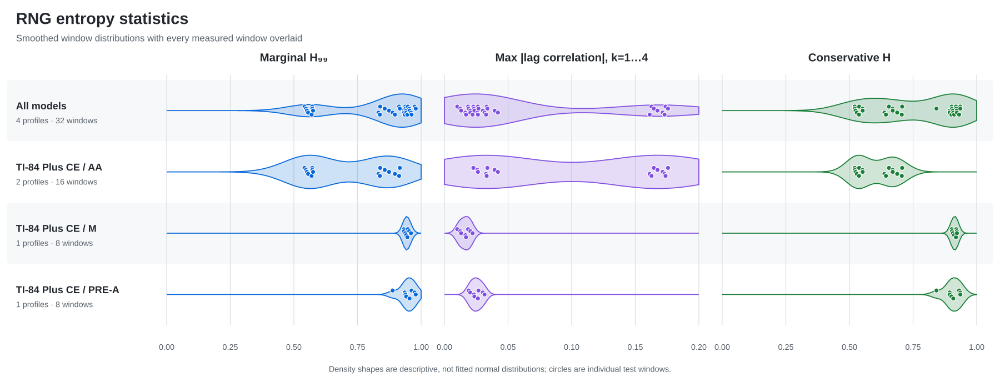

# RNG entropy statistics

Processed **4 profiles** and **32 test windows**. Entropy values are bits per raw bit.

> Smoothed distributions are descriptive rather than fitted normal curves. Every circle is an individual test window.

## Aggregate

| Model | Sample size | H₉₉ | Markov H₉₉ | Adjusted H₉₉ |
|---|---:|---:|---:|---:|
| All models | 1,048,576 bits 32 windows | 0.541947 | 0.520507 | 0.520507 |

## Per model

| Model | Sample size | H₉₉ | Markov H₉₉ | Adjusted H₉₉ |
|---|---:|---:|---:|---:|
| TI-84 Plus CE / AA | 524,288 bits 16 windows | 0.541947 | 0.520507 | 0.520507 |
| TI-84 Plus CE / M | 262,144 bits 8 windows | 0.932816 | 0.901891 | 0.901891 |
| TI-84 Plus CE / PRE-A | 262,144 bits 8 windows | 0.888241 | 0.842106 | 0.842106 |

## Production health-test diagnostics

| Model | Runs | Masks (evaluated/passed) | Failures |
|---|---:|:---:|---|
| All models | 0 | n/a | RCT 0 · APT 0/0 Startup 0 · Lag 1–4 0/0/0/0 · Distribution 0/0 |
| TI-84 Plus CE / AA | 0 | n/a | RCT 0 · APT 0/0 Startup 0 · Lag 1–4 0/0/0/0 · Distribution 0/0 |
| TI-84 Plus CE / M | 0 | n/a | RCT 0 · APT 0/0 Startup 0 · Lag 1–4 0/0/0/0 · Distribution 0/0 |
| TI-84 Plus CE / PRE-A | 0 | n/a | RCT 0 · APT 0/0 Startup 0 · Lag 1–4 0/0/0/0 · Distribution 0/0 |

## Interpretation

- **H₉₉** is the lower 99% marginal MCV estimate, conservatively taking the poorer of the pooled and worst-window results.
- **Worst ρ₁…₄** uses the stationary-binary correlation heuristic `1-qₖ/(2p₀p₁)`; these values diagnose periodicity and do not add entropy credit.
- **Projected lag-screen failures** compares each version 3-or-newer run's aggregate lag rates with the startup bounds; version 4 health diagnostics separately count exact non-overlapping 952-sample windows.
- **Adjusted H₉₉** is the lower of the marginal and first-order Markov estimates.
- The aggregate headline is a worst-supported bound across the dataset, not an average calculator.

> ⚠️ The Markov result is a coarse first-order dependence bound, not a complete SP 800-90B non-IID entropy assessment; longer-range dependence can reduce actual min-entropy. Lag-2 through lag-4 results are diagnostics only and do not increase entropy credit.
